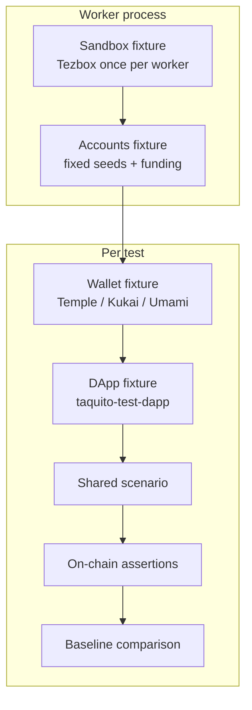

# Tezos Wallet E2E Harness — Proposal

This document is a starting point for an automated E2E testing setup that runs Beacon/Taquito wallet flows against real wallets (Temple, Kukai, Umami) on a deterministic local chain.

The goal is to reduce manual testing overhead while catching regressions in connect, permission, and operation signing flows.

## Background

Manual testing of Beacon flows against real wallets is slow and hard to keep consistent. The wallets that matter most are Temple (browser extension), Kukai (web), and Umami (desktop Electron). All are open source.

Existing pieces we can reuse:

- `taquito-test-dapp-vue` (or similar) as the dApp under test
- Tezbox or Flextesa for a local sandbox
- Playwright for browser/Electron automation

Determinism is important. Fixed accounts, controlled chain state, and on-chain verification as the source of truth help keep runs stable.

## Recommended Folder Structure

```
tezos-wallet-e2e-harness/
├── playwright.config.ts
├── package.json
├── docker-compose.yml              # Tezbox
├── .env.example
├── baselines/                      # scrubbed expected results
│   ├── connect/
│   ├── transfer/
│   └── contract-call/
├── fixtures/
│   ├── index.ts                    # re-export extended test
│   ├── sandbox.fixture.ts          # Tezbox lifecycle (worker-scoped)
│   ├── accounts.fixture.ts         # deterministic seeds + funding
│   ├── dapp.fixture.ts             # taquito-test-dapp page
│   └── wallets/
│       ├── temple.fixture.ts
│       ├── kukai.fixture.ts
│       └── umami.fixture.ts
├── drivers/                        # wallet-specific interaction logic
│   ├── wallet-driver.interface.ts
│   ├── temple.driver.ts
│   ├── kukai.driver.ts
│   └── umami.driver.ts
├── scenarios/                      # shared tests (parameterized by wallet)
│   ├── connect.spec.ts
│   ├── transfer.spec.ts
│   └── contract-call.spec.ts
├── helpers/
│   ├── baseline.ts                 # scrub + compare
│   ├── tezos.ts                    # RPC queries, wait for inclusion
│   └── locators.ts
└── scripts/
    └── start-sandbox.sh
```

## High-Level Architecture



### Wallet Driver Interface

Scenarios only talk to a common interface. Each wallet has its own driver that knows how to click through its confirmation UI.

```ts
interface WalletDriver {
  connect(): Promise<void>;
  approvePermission(): Promise<void>;
  approveOperation(expected?: Partial<OperationDetails>): Promise<void>;
  reject(): Promise<void>;
  getAddress(): Promise<string>;
}
```

### Playwright Projects

`playwright.config.ts` defines three projects so the same scenarios can run against each wallet:

```ts
projects: [
  { name: 'temple', use: { /* temple fixture */ } },
  { name: 'kukai',  use: { /* kukai fixture */ } },
  { name: 'umami',  use: { /* umami fixture */ } },
]
```

## Proposed Test Flow

1. Worker starts and launches Tezbox (worker-scoped fixture).
2. Accounts fixture imports fixed mnemonics and funds them if needed.
3. For each test:
   - Wallet fixture starts the target wallet (persistent context for Temple, normal page for Kukai, Electron for Umami).
   - DApp fixture opens the test dApp pointed at the local network.
   - Scenario calls the driver methods (connect, approve, etc.).
   - Helper queries Tezbox RPC to confirm the operation was included and storage/balances match expectations.
   - Baseline helper compares the scrubbed result against the stored JSON (or updates it when `UPDATE_BASELINES=1`).
4. Wallet context is closed. Next test gets a clean one.

## Playwright Practices We Will Follow

From the current Playwright docs:

- Prefer fixtures (`test.extend`) over heavy `beforeAll`/`afterAll` for setup and teardown. Worker-scoped fixtures are a good fit for the sandbox.
- Use role, label, and test-id locators inside the drivers. Avoid long CSS/XPath chains.
- Prefer web-first assertions (`await expect(locator).toBeVisible()`) so Playwright waits and retries.
- Keep tests isolated. Each test gets its own browser context.
- Enable `trace: 'on-first-retry'` and use the Trace Viewer / UI Mode while developing.
- Use projects to run the same scenarios against different wallets.
- For Temple: `launchPersistentContext` with the extension loaded and a fixed user-data directory that already has the seed.
- For Umami: `_electron.launch` + `firstWindow()` (Electron support is experimental but documented).

## Baseline Strategy

After a successful flow we capture a scrubbed result:

- Operation inclusion status
- Balance deltas
- Contract storage (if any)
- Relevant UI status text

Hashes, timestamps, and Beacon request IDs are stripped before comparison. The helper does a deep equality check against the file under `baselines/`.

## Determinism Levers

| Concern              | Approach                                      |
|----------------------|-----------------------------------------------|
| Account keys         | Fixed mnemonic imported into each wallet      |
| Chain state          | Fresh Tezbox per worker (or controlled baking)|
| Timing               | Explicit waits + on-chain inclusion checks    |
| Beacon pairing       | Wait for specific UI states inside drivers    |
| Locators             | Role / test-id preferred                      |

## Suggested Starting Slice

1. Tezbox + Temple only.
2. `connect` and simple `transfer` scenarios.
3. On-chain balance assertion.
4. One baseline for the transfer result.
5. Then add Kukai, then Umami.

## Open Questions

- Exact Tezbox vs Flextesa choice and how baking is controlled.
- How to keep wallet extension/Electron versions pinned.
- Whether we store baselines per wallet or share them when the on-chain result is identical.
- How aggressively to update baselines in CI.

This document is intentionally short. The next concrete step is to add the Playwright config, the `WalletDriver` interface, a Temple fixture/driver stub, and one working scenario.
