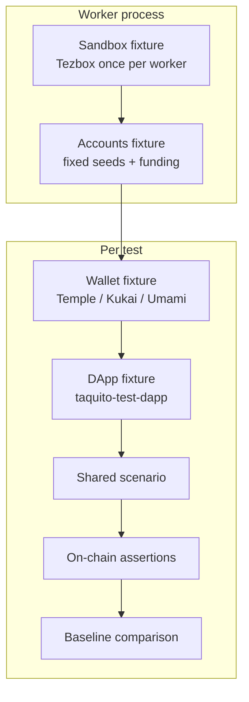

# Tezos Wallet E2E Harness: Proposal

This document is a starting point for an automated E2E testing setup that runs Beacon and Taquito wallet flows against real wallets (Temple, Kukai, Umami) on a deterministic local chain.

The goal is to reduce manual testing overhead while catching regressions in connect, permission, and operation signing flows. Beacon is the system under test. The wallets are the execution environments.

## Background

Manual testing of Beacon flows against real wallets is slow and hard to keep consistent. The wallets that matter most are Temple (browser extension), Kukai (web), and Umami (desktop Electron). All are open source.

### Why these components

We checked recent activity before choosing them:

- Temple: actively maintained, Chrome store updates through 2026
- Kukai: recent commits and releases
- Umami v2: Playwright already used in its own e2e tests, recent releases
- taquito-test-dapp-vue: updated in 2026, minimal Beacon + Taquito surface
- Tezbox: Docker-based, tracks recent Octez, easy to start

Flextesa remains an option if we need finer control over baking, but Tezbox is simpler for the first version.

Determinism is important. Fixed accounts, controlled chain state, and on-chain verification as the source of truth help keep runs stable.

## Recommended Folder Structure

```
tezos-wallet-e2e-harness/
├── playwright.config.ts
├── package.json
├── docker-compose.yml              # Tezbox
├── .env.example
├── baselines/                      # scrubbed expected results
│   ├── connect/
│   ├── transfer/
│   └── contract-call/
├── fixtures/
│   ├── index.ts                    # re-export extended test
│   ├── sandbox.fixture.ts          # Tezbox lifecycle (worker-scoped)
│   ├── accounts.fixture.ts         # deterministic seeds + funding
│   ├── dapp.fixture.ts             # taquito-test-dapp page
│   └── wallets/
│       ├── temple.fixture.ts
│       ├── kukai.fixture.ts
│       └── umami.fixture.ts
├── drivers/                        # wallet-specific interaction logic
│   ├── wallet-driver.interface.ts
│   ├── temple.driver.ts
│   ├── kukai.driver.ts
│   └── umami.driver.ts
├── scenarios/                      # shared tests (parameterized by wallet)
│   ├── connect.spec.ts
│   ├── transfer.spec.ts
│   └── contract-call.spec.ts
├── helpers/
│   ├── baseline.ts                 # scrub + compare
│   ├── tezos.ts                    # RPC queries, wait for inclusion
│   └── locators.ts
└── scripts/
    └── start-sandbox.sh
```

## High-Level Architecture



### High-Level Flow

```
Worker starts
  └─ Sandbox fixture (Tezbox) starts once per worker
  └─ Accounts fixture funds fixed seeds

Per test
  └─ Wallet fixture launches Temple / Kukai / Umami
  └─ DApp fixture opens taquito-test-dapp
  └─ Scenario runs against WalletDriver interface
  └─ On-chain assertions via Tezbox RPC
  └─ Baseline comparison (scrubbed JSON)
  └─ Wallet context torn down
```

### Wallet Driver Interface

Scenarios only talk to a common interface. Each wallet has its own driver that knows how to click through its confirmation UI.

```ts
interface WalletDriver {
  connect(): Promise<void>;
  approvePermission(): Promise<void>;
  approveOperation(expected?: Partial<OperationDetails>): Promise<void>;
  reject(): Promise<void>;
  getAddress(): Promise<string>;
}
```

### Playwright Projects

`playwright.config.ts` defines three projects so the same scenarios can run against each wallet:

```ts
projects: [
  { name: 'temple', use: { /* temple fixture */ } },
  { name: 'kukai',  use: { /* kukai fixture */ } },
  { name: 'umami',  use: { /* umami fixture */ } },
]
```

## Proposed Test Flow

1. Worker starts and launches Tezbox (worker-scoped fixture).
2. Accounts fixture imports fixed mnemonics and funds them if needed.
3. For each test:
   - Wallet fixture starts the target wallet (persistent context for Temple, normal page for Kukai, Electron for Umami).
   - DApp fixture opens the test dApp pointed at the local network.
   - Scenario runs the TZIP-10 / Taquito action (transfer, originate, call, batch, sign, etc.).
   - Wallet driver confirms the operation in its UI.
   - Helper queries Tezbox RPC to confirm the operation was included and storage or balances match expectations.
   - Baseline helper compares the scrubbed result against the stored JSON (or updates it when `UPDATE_BASELINES=1`).
4. Wallet context is closed. Next test gets a clean one.

## Fixture Examples

### Temple

```ts
// fixtures/wallets/temple.fixture.ts
export const test = base.extend<{ wallet: TempleDriver }>({
  wallet: async ({}, use) => {
    const context = await chromium.launchPersistentContext(userDataDir, {
      headless: false, // or true in CI
      args: [`--disable-extensions-except=${extensionPath}`, `--load-extension=${extensionPath}`],
    });
    const driver = new TempleDriver(context);
    await driver.ensureUnlocked();
    await use(driver);
    await context.close();
  },
});
```

### Kukai

```ts
// fixtures/wallets/kukai.fixture.ts
export const test = base.extend<{ wallet: KukaiDriver }>({
  wallet: async ({ page }, use) => {
    await page.goto(kukaiUrl);
    const driver = new KukaiDriver(page);
    await driver.ensureUnlocked();
    await use(driver);
  },
});
```

### Umami

```ts
// fixtures/wallets/umami.fixture.ts
export const test = base.extend<{ wallet: UmamiDriver }>({
  wallet: async ({}, use) => {
    const electronApp = await _electron.launch({ args: [umamiMainPath] });
    const window = await electronApp.firstWindow();
    const driver = new UmamiDriver(window);
    await driver.ensureUnlocked();
    await use(driver);
    await electronApp.close();
  },
});
```

## Playwright Practices We Will Follow

From the current Playwright docs:

- Prefer fixtures (`test.extend`) over heavy `beforeAll`/`afterAll` for setup and teardown. Worker-scoped fixtures are a good fit for the sandbox.
- Use role, label, and test-id locators inside the drivers. Avoid long CSS or XPath chains.
- Prefer web-first assertions (`await expect(locator).toBeVisible()`) so Playwright waits and retries.
- Keep tests isolated. Each test gets its own browser context.
- Enable `trace: 'on-first-retry'` and use the Trace Viewer or UI Mode while developing.
- Use projects to run the same scenarios against different wallets.
- Prefer project dependencies for any global setup over the older `globalSetup` option.
- For Temple: `launchPersistentContext` with the extension loaded and a fixed user-data directory that already has the seed.
- For Umami: `_electron.launch` + `firstWindow()` (Electron support is experimental but documented).
- If Beacon or wallet pages use service workers and network events go missing, set `serviceWorkers: 'block'`.

### Key Playwright APIs We Will Use

- `test.extend()` and worker-scoped fixtures
- `chromium.launchPersistentContext()` (Temple)
- `_electron.launch()` and `electronApp.firstWindow()` (Umami)
- `page.getByRole()`, `getByTestId()`, `getByLabel()` inside drivers
- Web-first assertions (`toBeVisible`, `toHaveText`, etc.)
- `request` fixture or a custom fixture for Tezbox RPC checks
- Trace Viewer and UI Mode during development

### Electron Challenges

Umami is an Electron app. Playwright's Electron support is experimental. Common issues include:

- Launch timeouts if the Node CLI inspect fuse is disabled
- Native dialogs are not intercepted (they go straight to OS APIs)
- Window management differs from browser contexts
- Debugging is harder than for browser extensions or web pages

We accept these trade-offs for now and keep Umami behind its own driver so the rest of the suite stays stable.

## Baseline Strategy

On-chain results are the primary assertion. UI checks are secondary.

After a successful flow we capture a scrubbed result:

- Operation inclusion status
- Balance deltas
- Contract storage (if any)
- Relevant UI status text

Hashes, timestamps, Beacon request IDs, and network IDs are stripped before comparison. The helper does a deep equality check against the file under `baselines/`.

We store baselines per scenario. When the on-chain result is identical across wallets we can share the file; otherwise we keep wallet-specific copies.

## Determinism Levers

| Concern              | Approach                                      |
|----------------------|-----------------------------------------------|
| Account keys         | Fixed mnemonic imported into each wallet      |
| Chain state          | Fresh Tezbox per worker (or controlled baking)|
| Timing               | Explicit waits + on-chain inclusion checks    |
| Beacon pairing       | Wait for specific UI states inside drivers    |
| Locators             | Role / test-id preferred                      |
| Non-deterministic fields | Scrub hashes, timestamps, Beacon IDs, network IDs |

Additional concrete measures:

- Use a fixed set of mnemonics (or key-of-name style accounts) so addresses stay the same across runs.
- Prefer manual or controlled baking after each operation so block times and inclusion are predictable.
- Pin Tezbox Docker image tags and wallet versions (or known-good commits) so CI does not drift.

## Wallet-Specific Strategies

- Temple: load the unpacked extension via `launchPersistentContext`, use a pre-populated user-data directory with the seed already imported, and handle the extension popup for approvals.
- Kukai: treat it as a normal web page. Pairing can be done via deep link or by filling the pairing UI. Timing races with Beacon are common; wait for concrete UI states.
- Umami: launch with `_electron.launch`, get the window with `firstWindow()`, and drive the Electron UI. Confirmation dialogs differ from the browser wallets. Electron support is experimental, so expect more flakiness and longer timeouts.

These differences stay inside the drivers. Scenarios stay the same.

## Suggested Starting Slice

1. Tezbox + Temple only.
2. `connect` and simple `transfer` scenarios.
3. On-chain balance assertion.
4. One baseline for the transfer result.
5. Then add Kukai, then Umami.

## Open Questions

- Exact Tezbox vs Flextesa choice and how baking is controlled.
- How to keep wallet extension and Electron versions pinned.
- Whether we store baselines per wallet or share them when the on-chain result is identical.
- How aggressively to update baselines in CI (and who reviews the diffs).

This document is intentionally short. The next concrete step is to add the Playwright config, the `WalletDriver` interface, a Temple fixture and driver stub, and one working scenario.
